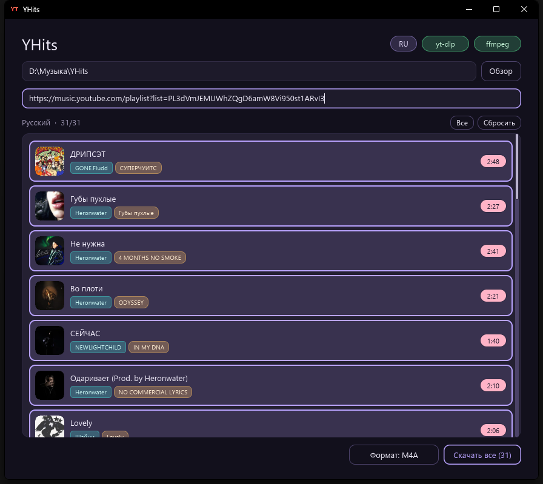
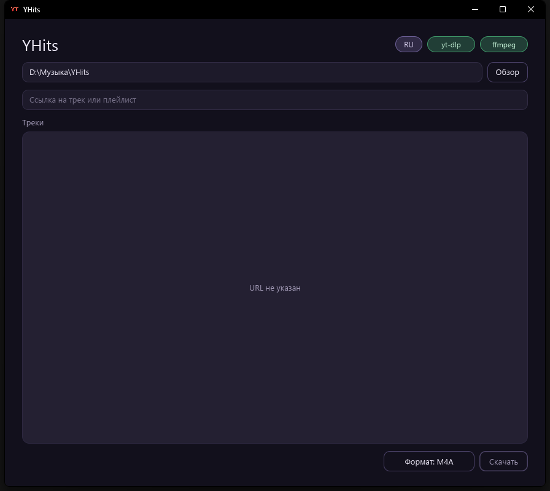

# YHits

[Русский](README.ru.md)

Desktop app for downloading audio from **YouTube** and **YouTube Music**. Paste a track or playlist link, pick what you want, choose the output format, and save tagged audio files.

<p align="center">
  
</p>

<p align="center">
  
</p>

## Features

- Preview tracks from a single video or a full playlist / album
- Covers, titles, artists, albums, and durations in the list
- Select all, clear, or click rows to choose what to download
- Output format: **M4A**, **MP3**, **Opus**, **FLAC**, or **WAV** (choice is remembered)
- Embedded metadata and thumbnail when the format supports it
- Built-in checks for **yt-dlp** and **ffmpeg** (install via winget from the UI)
- UI language: **English / Russian**
- Remembers the last output folder and format

## Requirements

- Windows
- [Rust](https://rustup.rs/) (to build from source)
- [yt-dlp](https://github.com/yt-dlp/yt-dlp) and [ffmpeg](https://ffmpeg.org/) — can be installed from the app

## Build & run

```bash
cargo run --release
```

Binary: `target/release/YHits.exe`

## Usage

1. Choose a folder for downloads (or keep the default).
2. Paste a `youtube.com`, `music.youtube.com`, or `youtu.be` link.
3. Wait for the track list, then select tracks.
4. Pick the output format next to **Download**.
5. Press **Download** / **Download selected**.

During download you can cancel; if some tracks fail, retry only the failed ones.

## Stack

- Rust + [iced](https://iced.rs/) UI
- yt-dlp for listing and downloading
- ffmpeg for audio extract / remux / convert
