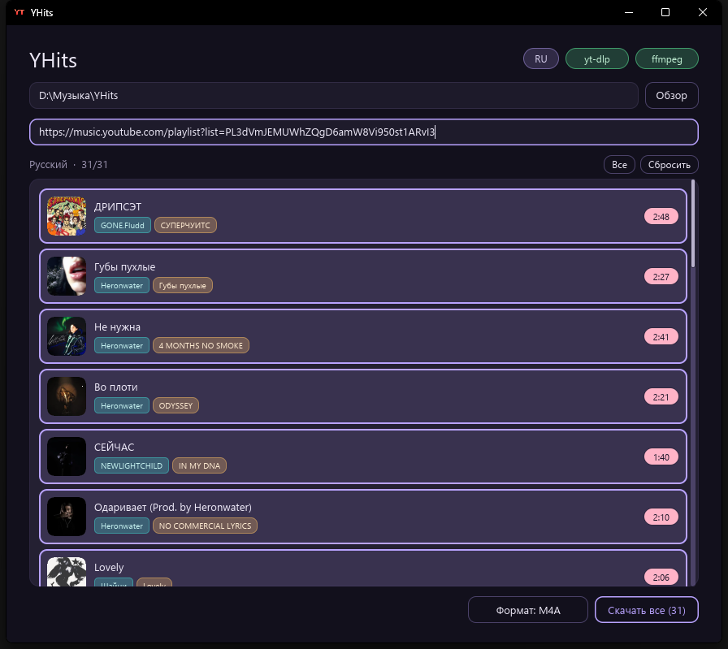
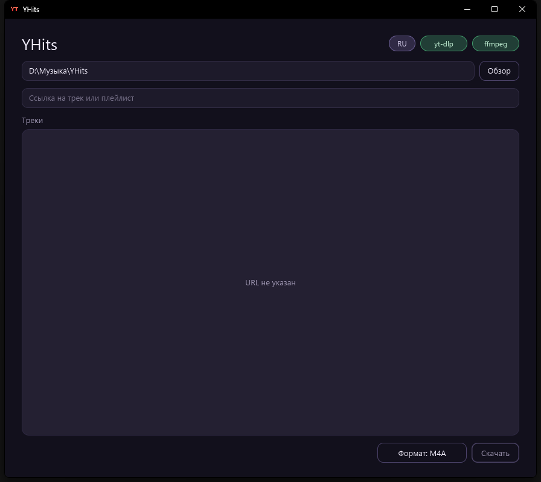

# YHits

[English](README.md)

Десктоп-приложение для скачивания аудио с **YouTube** и **YouTube Music**. Вставьте ссылку на трек или плейлист, выберите нужное, укажите формат и сохраните аудио с тегами и обложкой.

<p align="center">
  
</p>

<p align="center">
  
</p>

## Возможности

- Превью треков из одного ролика или целого плейлиста / альбома
- Обложки, названия, артисты, альбомы и длительность в списке
- Выбор треков: все, сброс или клик по строке
- Итоговый формат: **M4A**, **MP3**, **Opus**, **FLAC** или **WAV** (выбор запоминается)
- Встроенные метаданные и обложка, если формат это поддерживает
- Проверка **yt-dlp** и **ffmpeg** (установка через winget из интерфейса)
- Язык интерфейса: **русский / английский**
- Запоминает папку сохранения и формат

## Требования

- Windows
- [Rust](https://rustup.rs/) (для сборки из исходников)
- [yt-dlp](https://github.com/yt-dlp/yt-dlp) и [ffmpeg](https://ffmpeg.org/) — можно поставить прямо из приложения

## Сборка и запуск

```bash
cargo run --release
```

Бинарник: `target/release/YHits.exe`

## Как пользоваться

1. Выберите папку для загрузок (или оставьте по умолчанию).
2. Вставьте ссылку `youtube.com`, `music.youtube.com` или `youtu.be`.
3. Дождитесь списка треков и отметьте нужные.
4. Выберите формат рядом с кнопкой **Скачать**.
5. Нажмите **Скачать** / **Скачать выбранные**.

Во время загрузки можно отменить; если часть треков не скачалась — повторить только неудачные.

## Стек

- Rust + UI на [iced](https://iced.rs/)
- yt-dlp для списка и скачивания
- ffmpeg для извлечения / remux / конвертации аудио
